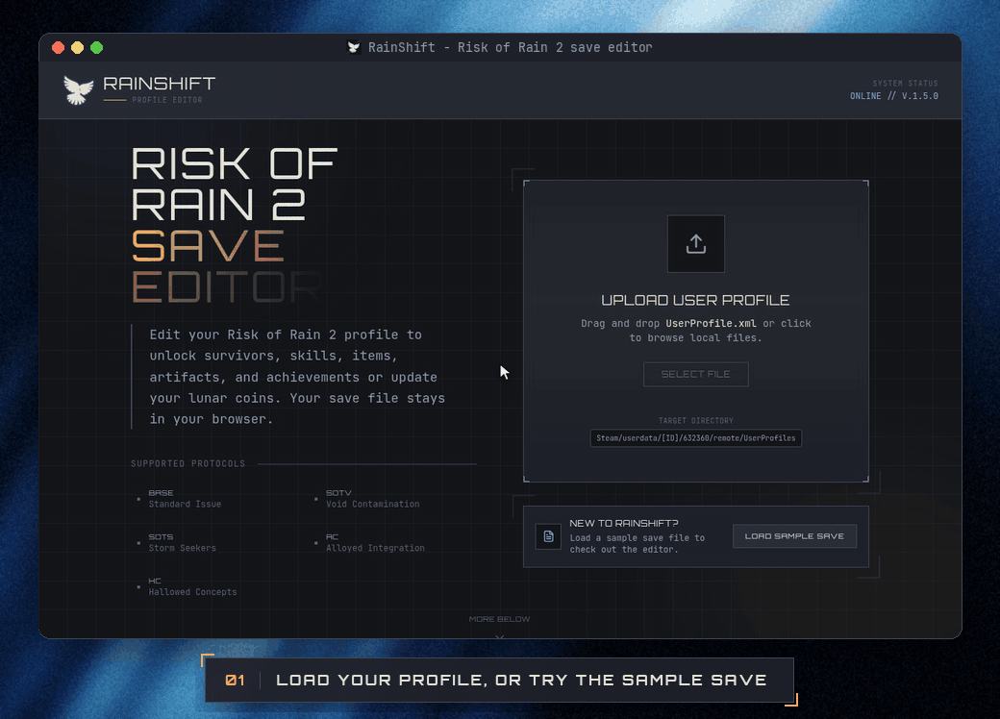

<div align="center">

# RainShift

**A save editor for Risk of Rain 2, right in your browser.**

Unlock achievements, fill in the logbook, set Eclipse progress and more.<br>
Your save never leaves your machine.




</div>

## ✨ Features

| | |
| --- | --- |
| 🏆 **Achievements** | Unlock or lock all 205 achievements, along with the survivors, skills and skins they grant. Search by name, by what an achievement unlocks (`captain` → *Washed Away*) or by community nicknames. |
| 📖 **Logbook** | Discover items, equipment, monsters, environments, survivors and drones. |
| 🦎 **Newt Altars** | Mark altars as found, stage by stage. |
| 🌑 **Eclipse** | Set the highest Eclipse level each survivor has beaten. |
| ☯️ **Starting Karma** | Choose the highest unlocked starting karma level. |
| 🌙 **Lunar Coins** | Set your coin count. |

Covers the base game and every DLC: **Survivors of the Void**, **Seekers of the Storm**, **Alloyed Collective** and **Hallowed Concepts**.

> [!NOTE]
> RainShift writes the same save keys the game does. Each one was checked against the game's code, so edited saves load like normally earned progress.

## 🚀 Usage

1. **Close Risk of Rain 2.**
2. **Back up your profile.** It's the `.xml` file in:
   ```
   Steam/userdata/<steam-id>/632360/remote/UserProfiles/
   ```
   Steam is usually installed in `C:\Program Files (x86)\Steam` on Windows and `~/.local/share/Steam` on Linux.
3. **Load the file** in RainShift, or click **Load sample save** to try it first.
4. **Make your edits**, then click **Export**. The edited save downloads under the same file name.
5. **Replace the original file** with the downloaded one.

> [!WARNING]
> Steam Cloud may restore the old profile. If your changes don't show up in game, turn off Steam Cloud for Risk of Rain 2 and replace the file again.

## 🛠️ Development

Requires [Bun](https://bun.sh).

```bash
bun install
bun dev            # http://localhost:3000
```

| Command | What it does |
| --- | --- |
| `bun run build` | Production build |
| `bun run lint` | Lint and format check (Biome) |
| `bun run format` | Format with Biome |
| `bunx vitest run` | Run the tests once (`bun run test` runs them in watch mode) |
| `bunx tsc --noEmit` | Type check |

### Game data

The logbook, unlock names, Eclipse medals, karma levels and newt altars are generated from a local Risk of Rain 2 install, so don't edit the generated files by hand. After a game update, regenerate them with [uv](https://docs.astral.sh/uv/):

```bash
uv run scripts/generate-logbook.py                    # everything
uv run scripts/generate-logbook.py --only items,equipment
uv run scripts/generate-logbook.py --game "/path/to/Risk of Rain 2"
```

By default the generator looks for the game in the Linux Steam library (`~/.local/share/Steam/steamapps/common/Risk of Rain 2`).

<details>
<summary><b>Generated files</b></summary>

- `src/data/logbook/`
- `src/data/unlockable-names.ts`
- `src/data/karma-levels.ts`
- `src/data/newt-altars.ts`
- `public/logbook/`, `public/eclipse/`, `public/karma/`

</details>

### Project layout

```
src/
  app/            Next.js pages
  components/     Editor UI, one component per tab
  data/           Achievements, DLC names and generated game data
  lib/            Save parsing (xml-parser.ts) and edits (save-operations.ts, eclipse.ts, karma.ts, ...)
scripts/          Game data generator
tests/            Vitest tests
```

## 🤝 Contributing

Issues and pull requests are welcome. Please use [conventional commits](https://www.conventionalcommits.org/) (`feat:`, `fix:`, `chore:`, ...).

## ⚖️ Disclaimer

RainShift is a fan-made tool. It isn't affiliated with Hopoo Games or Gearbox Publishing. Risk of Rain 2 and its assets belong to their respective owners. Always back up your save before editing it.
